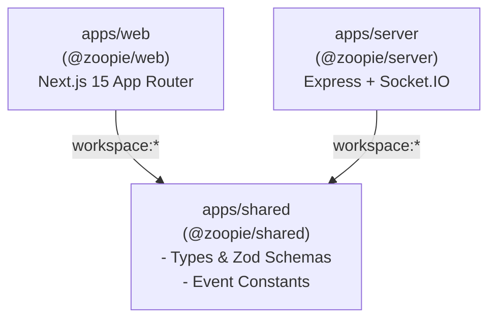

# Zoopie System Architecture & Specification

## 1. Overview & Vision

**Zoopie** is a modern, low-latency, real-time interactive communication platform designed for frictionless peer-to-peer audio, video, and real-time interaction.

Phase 1 establishes the rock-solid architectural foundation:

- **pnpm Monorepo** with unified workspace management
- **Strict TypeScript** across every workspace package
- **Next.js 15 App Router** for the modern web frontend
- **Express & Socket.IO** for low-latency WebSocket communication
- **Shared Contracts (`apps/shared`)** enforcing runtime type safety with Zod
- **Vitest & Playwright** for comprehensive testing coverage
- **Independent Execution**: Frontend and backend can run, build, and fail independently without taking down the developer workflow.

---

## 2. Monorepo Topology

```
zoopie/
├── apps/
│   ├── web/               # Next.js 15 App Router (Frontend UI & Socket client)
│   ├── server/            # Express + Socket.IO Server Gateway
│   └── shared/            # Shared Types, Zod Schemas & Event Constants
├── docs/
│   └── ARCHITECTURE.md    # System Architecture Document (this file)
├── .env.example           # Root environment variable template
├── package.json           # Root scripts and developer tooling
├── pnpm-workspace.yaml    # pnpm workspace configuration
├── tsconfig.base.json     # Strict shared TypeScript base config
├── vitest.workspace.ts    # Multi-project Vitest configuration
├── playwright.config.ts   # E2E test suite configuration
└── README.md              # Local developer onboarding guide
```

### Dependency Graph



---

## 3. Technology Stack

| Layer                        | Technology                         | Purpose                                         |
| ---------------------------- | ---------------------------------- | ----------------------------------------------- |
| **Package Manager**          | `pnpm` (v12+)                      | Fast, disk-efficient workspace management       |
| **Frontend Framework**       | Next.js 15 (App Router) + React 19 | Server/Client rendering, responsive UI          |
| **Styling**                  | Tailwind CSS + Lucide Icons        | Utility-first, responsive, accessible design    |
| **Backend Framework**        | Express 4 + Node.js (v24)          | REST APIs, health checks, HTTP lifecycle        |
| **Real-time Gateway**        | Socket.IO 4                        | WebSocket transport with fallback, typed events |
| **Type & Contract System**   | TypeScript 5 (Strict) + Zod        | Compile-time & runtime schema validation        |
| **Unit / Integration Tests** | Vitest 3 + Supertest + RTL         | High-speed unit & integration test runner       |
| **End-to-End Tests**         | Playwright                         | Browser automation & smoke testing              |
| **Linting & Formatting**     | ESLint 9 (Flat config) + Prettier  | Code quality & formatting consistency           |

---

## 4. Communication & Networking Architecture

### 4.1 REST API: Health Check

The backend exposes `GET /health` to verify server uptime, process health, and environment metadata:

- **Endpoint**: `GET /health`
- **Response Format**:
  ```json
  {
    "status": "ok",
    "uptime": 128,
    "timestamp": "2026-10-25T07:45:00.000Z",
    "service": "zoopie-server",
    "version": "0.1.0",
    "environment": "development"
  }
  ```
- **Validation**: Enforced by `HealthCheckResponseSchema` from `@zoopie/shared` on both server output and client consumption.

### 4.2 Real-Time WebSocket Gateway

Socket.IO handles real-time bidirectional events:

- **Ping/Pong Protocol**:
  - Client emits `SOCKET_EVENTS.PING` with `{ clientTimestamp, nonce }`.
  - Server validates against `PingPayloadSchema`.
  - Server replies with `SOCKET_EVENTS.PONG` containing `{ clientTimestamp, serverTimestamp, message }`.
  - Client measures Round Trip Time (RTT) latency.

### 4.3 CORS & Security Policies

- **Origin Control**: Controlled via `CLIENT_ORIGIN` environment variable (defaults to `http://localhost:3000` in development).
- **Credentials Support**: Enabled for secure cross-origin handshakes.
- **Secret Safety**: No secrets or credentials are hardcoded. `.env` files are ignored by git, and safe defaults are provided in `.env.example`.

---

## 5. Independent Execution Principle

Zoopie is engineered so that frontend and backend developers can work autonomously:

1. **Frontend Resilience**: If `apps/server` is not running, `apps/web` boots cleanly, loads the interface, and displays graceful "Backend Offline" status indicators with retry mechanisms rather than throwing unhandled exceptions.
2. **Backend Independence**: `apps/server` can be spun up, tested via Vitest or cURL/Postman, without needing the frontend running.
3. **Dedicated Dev Scripts**:
   - Run both concurrently: `pnpm dev`
   - Run backend only: `pnpm dev:server`
   - Run frontend only: `pnpm dev:web`

---

## 6. Implementation Status & Roadmap

- **Phase 1 — Project Foundation & Architecture**: Complete. Monorepo, strict TypeScript, Next.js App Router, Express, Socket.IO gateway, shared contracts, and Vitest suite.
- **Phase 2 — Design System & Landing Page**: Complete. Zoopie brand identity, custom SVG wordmark, responsive landing page, design tokens, accessible UI component primitives, Safety/Privacy/Terms foundations.
- **Phase 3 — Database, API Contracts & Security Baseline**: Complete. PostgreSQL Prisma schema, opaque identifiers, migration guide, centralized error handling, security headers, rate limiting, and redacting logger.
- **Phase 4 — Real-Time Socket Layer & Text Chat**: Complete. Typed Socket.IO event contracts, room isolation, message length & rate limiting, XSS-immune plain text rendering, and ephemeral in-memory relay (zero chat persistence).
- **Phase 5 — Server-Authoritative Matchmaking**: Complete. Separate queues by mode (text/video), optional interest matching with documented fallback relaxation, self-matching & duplicate match prevention, block exclusion, atomic concurrency safety, skip/stop flows, stale event guards, honest UI states (`idle`, `searching`, `waiting`, `matched`, `connecting`, `connected`, `skipping`, `stopping`, `error`), and `IMatchmakingQueue` architecture.
- **Phase 6 — WebRTC Audio/Video Signaling & Media Pipeline**: Complete. Direct peer-to-peer audio/video streaming, deliberate permission gate, local preview & remote video players, RTCPeerConnection lifecycle, authorized Socket.IO signaling, STUN/TURN endpoint with ephemeral credentials, mic/camera toggle controls, glare prevention, and safe diagnostics.
- **Phase 7 — Abuse Reporting & Moderation Engine**: Reporting workflows, automated content flags, moderator dashboard, session suspension enforcement.
