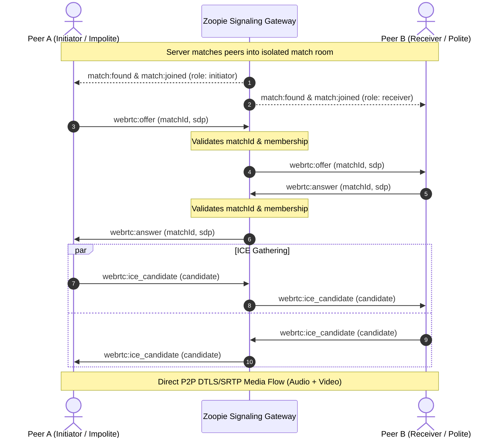

# Zoopie WebRTC Media Pipeline & Signaling Specification

## 1. Overview

Zoopie implements real, browser-to-browser WebRTC video and audio for spontaneous peer-to-peer conversations.
Ordinary audio/video media streams **never** transit through Socket.IO application messages or server memory; they travel directly over encrypted peer-to-peer Datagram Transport Layer Security (DTLS) and Secure Real-time Transport Protocol (SRTP).

---

## 2. Signaling Protocol & Event Contracts

Signaling is handled over Socket.IO using strictly typed, server-authoritative contracts defined in `@zoopie/shared`:

### 2.1 Event Payloads

- `webrtc:offer`: Validated with `WebRtcOfferPayloadSchema` (`matchId`, `sdp`, `type: 'offer'`).
- `webrtc:answer`: Validated with `WebRtcAnswerPayloadSchema` (`matchId`, `sdp`, `type: 'answer'`).
- `webrtc:ice_candidate`: Validated with `WebRtcIceCandidatePayloadSchema` (`matchId`, `candidate`).

### 2.2 Server-Side Authorization Invariants

1. **Match Membership**: Every signaling payload must contain `matchId`. The server checks `matchManager.isAuthorizedParticipant(matchId, sessionId)`.
2. **Room Isolation**: Signals are broadcast solely within the isolated Socket.IO room `match:${matchId}` (`socket.to(roomKey).emit(...)`). Sockets outside the room cannot receive or emit signals.
3. **Stale Signal Rejection**: If `socket.data.currentMatchId !== payload.matchId`, the signal is rejected with `UNAUTHORIZED_MATCH` error, preventing signals from an earlier conversation from disrupting a new pairing.

---

## 3. STUN and TURN Configuration & Security

### 3.1 Architecture

- **STUN (Session Traversal Utilities for NAT)**: Used for public IP and reflexive candidate discovery (default: `stun:stun.l.google.com:19302`).
- **TURN (Traversal Using Relays around NAT)**: Used when symmetric NAT or strict enterprise firewalls prevent direct peer-to-peer connection.

### 3.2 Ephemeral Credential Security (RFC 5766 REST API)

- **Zero Frontend Secret Exposure**: TURN shared secrets (`TURN_SERVER_SECRET`) are never packaged into client bundles, environment files exposed to the browser, or public API responses.
- **REST Endpoint**: `GET /api/webrtc/ice-servers`:
  - When `TURN_SERVER_SECRET` is configured on the backend, the server computes time-limited HMAC-SHA1 credentials:
    $$\text{timestamp} = \text{now}() + \text{TTL (e.g. 86400s)}$$
    $$\text{username} = `\$\{timestamp\}:\$\{crypto.randomUUID()\}`$$
    $$\text{credential} = \text{HMAC-SHA1}(\text{TURN\_SERVER\_SECRET}, \text{username}).\text{digest}('base64')$$
  - Returns `{ iceServers: [...], ttl: 86400 }` to authorized callers.

---

## 4. Perfect Negotiation & Glare Safeguards

Zoopie implements the W3C **Perfect Negotiation** pattern:

- **Role Assignment**: Initiator is **impolite**; Receiver is **polite**.
- **Glare Resolution**: If an offer arrives while `pc.signalingState !== 'stable'`:
  - The **polite** peer rolls back its local offer (`await pc.setLocalDescription({ type: 'rollback' })`) and applies the remote offer.
  - The **impolite** peer ignores the conflicting offer.
- **Candidate Buffering**: ICE candidates arriving before `setRemoteDescription` are buffered and flushed sequentially once the remote description is applied.

---

## 5. Media Lifecycle & Resource Cleanup

1. **Deliberate Permission Gate**: Camera and microphone are requested only upon explicit user button click ("Enable Camera & Mic"), preceded by clear privacy notices.
2. **Audio/Video Controls**:
   - Microphone: toggles `track.enabled` on local audio tracks with clear UI mute indicators.
   - Camera: toggles `track.enabled` on local video tracks with "Camera turned off" avatar fallback.
3. **Complete Teardown**:
   - Calling `Next` or `Stop`:
     - Closes `RTCPeerConnection`: `pc.close()`.
     - Nullifies track and candidate event handlers.
     - Releases camera hardware: `stream.getTracks().forEach(t => t.stop())`.
     - Resets video DOM elements: `videoElement.srcObject = null`.

---

## 6. Privacy & Diagnostics

The diagnostic panel surfaces real-time connection state (`pc.connectionState`, `pc.iceConnectionState`, `pc.signalingState`) without exposing:

- Private video or audio data
- SDP encryption keys or passwords
- Local network topology or private IP addresses
